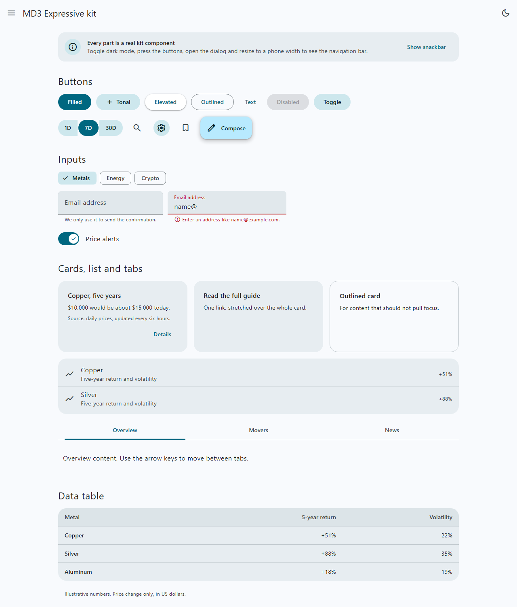
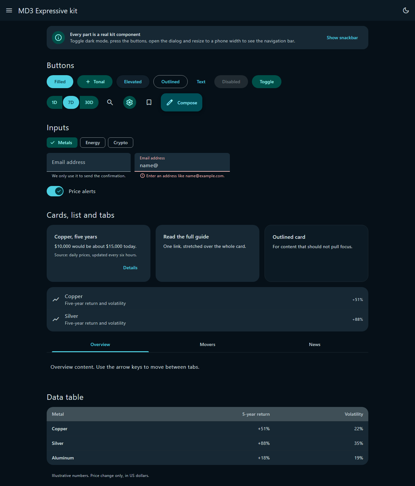

# Codex MD3 Expressive

[](https://github.com/ShlomyShLev/codex-md3-expressive/actions/workflows/test.yml)
[](LICENSE)


**Material Design 3 Expressive for Codex: a design skill, 18 ready-made components, and a local MCP server.**

Codex retrieves typography by purpose, builds from accessible components and theme tokens, then checks its output with a markup/CSS linter and contrast checker. This is an independent MIT-licensed kit, derived from [Claude MD3 Expressive](https://github.com/ShlomyShLev/claude-md3-expressive), originally developed from [gmdmarkets.com](https://gmdmarkets.com). It is not an official OpenAI or Google product.

<p align="center">
  
  
</p>

## Requirements

- Codex with local skills and MCP support.
- Node.js 18 or newer available as `node` on PATH. No npm dependencies are required.
- A local checkout of this repository, or its installed plugin copy.

The server uses STDIO, makes no network requests, and exposes tools that return text. It does not edit files or execute the source passed to its linter. Codex performs implementation edits under the user's normal workspace permissions.

## Install as a Codex plugin

Add the repository marketplace:

```text
codex plugin marketplace add ShlomyShLev/codex-md3-expressive
```

For a local checkout, use its root instead:

```text
codex plugin marketplace add "C:\path\to\codex-md3-expressive"
```

Open the desktop app's Plugins Directory, select the `codex-md3-expressive` marketplace, and install **Codex MD3 Expressive**. Open a new chat after installation, or restart the app if discovery has not refreshed. Verify that the skill and all eight MCP tools are available before relying on its checks.

The repository includes a portable `plugin.json` / `mcp.json` pair and a supported Codex compatibility `.codex-plugin/plugin.json` / `.mcp.json` pair. Both MCP definitions use `cwd: "."` and `./mcp-server/server.js`. The Codex compatibility layout uses the plugin root as the working directory, following the pattern used by bundled Codex plugins. It does not depend on Claude-specific variables. Plugin installation and MCP startup still require validation in your Codex version.

The repository marketplace is `.agents/plugins/marketplace.json`. Its `source.path` is relative to the repository root. The package is intended for local Codex use and GitHub distribution; it has not been submitted to OpenAI's public plugin directory.

## Install as a standalone skill and MCP

Use this alternative if your Codex host does not load the bundled local server. Choose either plugin installation or standalone installation to avoid duplicate skill and tool entries.

1. Clone this repository somewhere permanent.
2. Copy `skills/codex-md3-expressive` into your user skill directory, `~/.agents/skills/codex-md3-expressive`, or the project's `.agents/skills/codex-md3-expressive` directory. Copy the whole folder, including `references/` and `agents/`.
3. Register the MCP server using the absolute path to your checkout:

```text
codex mcp add codex-md3-expressive -- node "C:\path\to\codex-md3-expressive\mcp-server\server.js"
```

On macOS or Linux:

```text
codex mcp add codex-md3-expressive -- node /path/to/codex-md3-expressive/mcp-server/server.js
```

Alternatively, add this to your Codex `config.toml`, replacing the example path:

```toml
[mcp_servers.codex-md3-expressive]
command = "node"
args = ['C:\path\to\codex-md3-expressive\mcp-server\server.js']
```

Check `codex mcp list` and, in the CLI, `/mcp`. Skill dependency metadata describes the required server; it does not register or start it by itself. If the tools are unavailable, the skill can read its references but must disclose that MCP checks did not run.

Installation references: [Codex skills](https://learn.chatgpt.com/docs/build-skills), [Codex MCP](https://learn.chatgpt.com/docs/extend/mcp?surface=cli), and [plugin packaging](https://developers.openai.com/plugins/build/plugins).

## Use it

Ask for UI work naturally, or invoke the skill explicitly:

```text
Use $codex-md3-expressive to add a settings dialog with a notifications switch and Save / Cancel buttons.
```

Codex consults the checklist, selects existing components, retrieves the appropriate type roles, writes the implementation, lints the markup and CSS, and reviews the result. The skill respects AGENTS.md and workspace execution restrictions. It does not silently install a server or start a preview.

More examples:

- `Use $codex-md3-expressive to review this Razor page and report accessibility findings.`
- `Choose the type roles for dialog body text and snackbar text.`
- `Check the contrast of #777777 on white.`
- `Build a stylesheet with buttons, chips, and a data table.`

## MCP tools

| Tool | Purpose |
|---|---|
| `get_checklist` | Completion checklist, with a focus on page, dialog, form, navigation, or dashboard. |
| `get_tokens` | Light/dark color roles, typography, shape, spacing, motion, state layers, and elevation as CSS or JSON. |
| `get_type_role` | Type roles selected by purpose, such as dialog body or table cell. |
| `list_components` | Component catalog, optionally filtered by category. |
| `get_component` | Component specification, accessibility guidance, HTML, CSS, and JavaScript. |
| `build_stylesheet` | Tokens plus the CSS for selected components and their dependencies. |
| `lint_markup` | Source-text checks for HTML, Razor, JSX-like markup, and CSS, with line numbers and fixes. |
| `check_contrast` | WCAG contrast ratio for foreground/background hex colors, including translucent foregrounds. |

The MCP server is named `codex-md3-expressive`. Codex may namespace the tool names; the skill discovers them by their base names instead of assuming a fixed prefix.

## Components

| Category | Components |
|---|---|
| Foundation | `foundation` |
| Actions | `button`, `button-group`, `icon-button`, `chip`, `fab` |
| Navigation | `top-app-bar`, `navigation-bar`, `tabs` |
| Containers | `card`, `list` |
| Inputs | `text-field`, `switch` |
| Communication | `dialog`, `snackbar`, `banner` |
| Content | `data-table`, `toc-faq` |

Each component lives in `mcp-server/data/components/` and includes specification, accessibility, markup, stylesheet, and behavior sections. The copy retains the original CSS class and token names so the generated assets and demo remain consistent.

## Design rules

Typography follows purpose. Dialogs, banners, and prose use readable MD3 type roles; dense data scales belong in market data grids. Components use `--md-*` color roles, `--shape-*` shape tokens, and `--sp-*` spacing tokens. Controls have accessible names, selected states have matching ARIA states, dialog openers identify their purpose, headings form an outline, and motion respects reduced-motion preferences.

The six skill references cover typography, tokens, motion, components, accessibility, and anti-patterns. See [worked tool examples](docs/examples.md) for source and expected results.

## Development

```text
npm test
node scripts/build-css.js
node scripts/serve.js
```

The test suite covers contrast, tokens, components, lint rules, MCP protocol, documentation, generated asset freshness, and Codex packaging. GitHub Actions runs the suite on Windows and Linux. These commands are for maintainers; do not run them when the user's workspace instructions prohibit execution.

Generated assets are committed under `dist/`. Link `dist/md3-expressive.css` and `dist/md3-expressive.js` to use the components outside Codex. `examples/demo.html` demonstrates both themes. No font files are shipped; provide your fonts and Material Symbols subset.

## Limits and validation status

The linter reads text and cannot see rendered layout, mobile overflow, computed styles, actual backgrounds, focus behavior, or JavaScript state changes at runtime. A clean lint result is not a complete accessibility or visual assessment. Spring motion uses CSS easing approximations. The default palette is inherited from the original cyan theme.

Local validation on Windows completed on 2026-10-10: `npm run build:css` succeeded and `npm test` passed all 49 tests with zero failures or skipped tests. The suite starts the MCP server, completes its handshake, lists and calls all eight tools, and checks error handling. It also checks generated assets, lint rules, contrast, metadata, and the demo server's path protection. Plugin installation and tool discovery inside Codex itself have not yet been tested. The retained demo screenshots illustrate the source kit's components, not a verified Codex installation.

## License and attribution

MIT. The original [LICENSE](LICENSE) and author attribution are retained. This repository duplicates and adapts Claude MD3 Expressive 0.1.0 for Codex; it has no runtime dependency on the original checkout. See [CONTRIBUTING.md](CONTRIBUTING.md) and [CHANGELOG.md](CHANGELOG.md).
